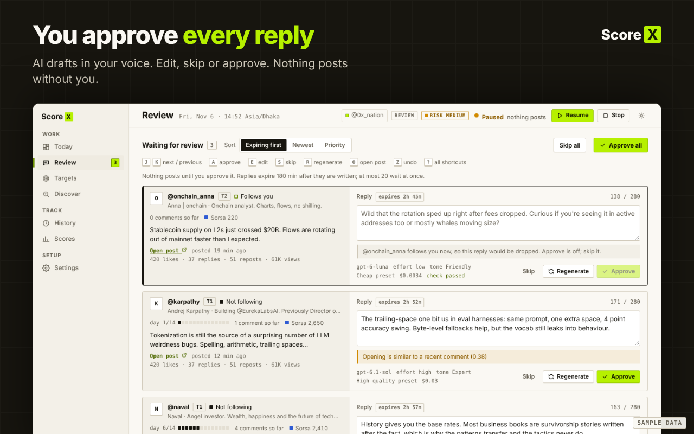
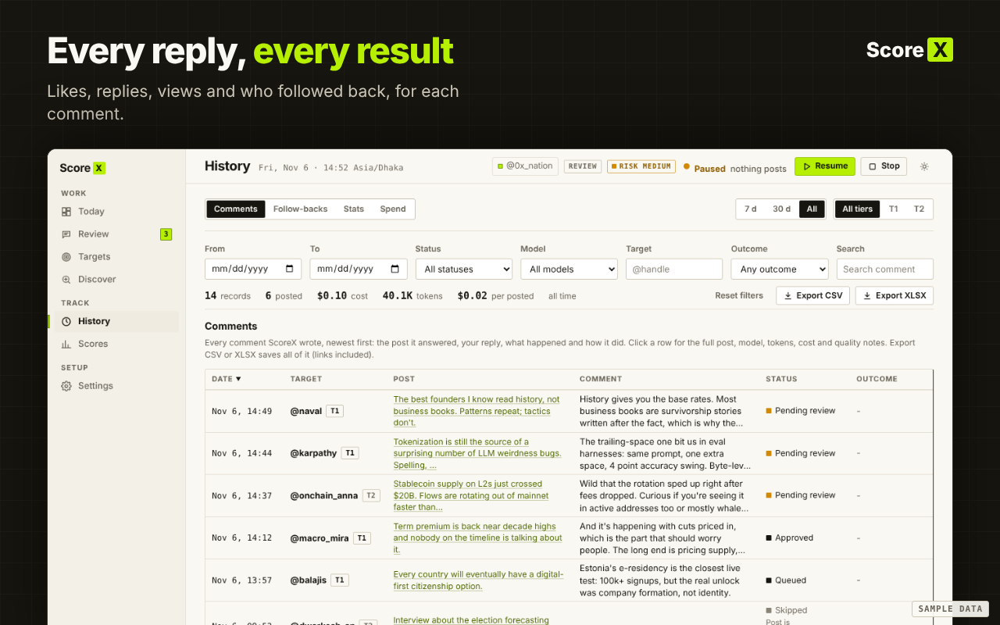
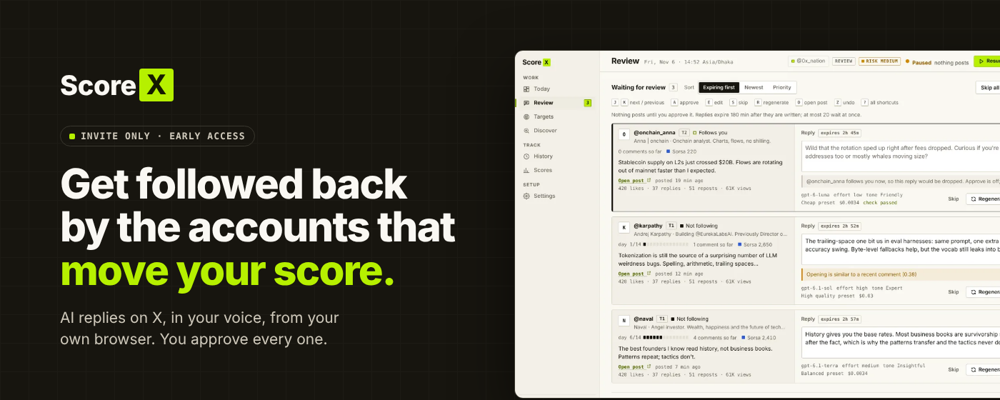

<div align="center">


<picture>
  <source media="(prefers-color-scheme: dark)" srcset="https://readme-typing-svg.demolab.com?font=Fira+Code&amp;weight=600&amp;size=22&amp;duration=3200&amp;pause=700&amp;color=FFB703&amp;center=true&amp;vCenter=true&amp;width=820&amp;height=48&amp;lines=Thoughtful+replies+on+X%2C+in+your+voice;Review+mode+by+default;Posted+from+your+own+browser+tab;Real+OpenAI+cost+tracking;Safety+limits+for+a+main+account" />
  <source media="(prefers-color-scheme: light)" srcset="https://readme-typing-svg.demolab.com?font=Fira+Code&amp;weight=600&amp;size=22&amp;duration=3200&amp;pause=700&amp;color=6C2BD9&amp;center=true&amp;vCenter=true&amp;width=820&amp;height=48&amp;lines=Thoughtful+replies+on+X%2C+in+your+voice;Review+mode+by+default;Posted+from+your+own+browser+tab;Real+OpenAI+cost+tracking;Safety+limits+for+a+main+account" />
  
</picture>

<br/>

<a href="https://scorex.uniquelabs.org"></a>
<a href="https://chromewebstore.google.com/detail/pckgdccdipdllagmieedopalgdoheklo"></a>


<br/>

**A Chrome extension that drafts short replies on X with OpenAI and posts them from your own logged-in tab.**

<a href="#overview">Overview</a> ·
<a href="#features">Features</a> ·
<a href="#stack">Tech stack</a> ·
<a href="#start">Getting started</a> ·
<a href="#config">Configuration</a> ·
<a href="#usage">Usage</a> ·
<a href="#safety">Safety</a> ·
<a href="#structure">Structure</a> ·
<a href="#credits">Credits</a>

</div>

> [!WARNING]
> **Read this first: no guarantees.**
>
> - X's rules restrict automated replies. Every safety feature below lowers the risk, but none of them makes automation undetectable or risk-free. Review mode (the default) is the safest way to use ScoreX.
> - The default volume is high (up to 200 replies a day, each with a like, around the clock). That is your choice as the account owner. A lower daily limit, a weekly ramp and active hours (Safety screen) lower the risk of X limiting the account. ScoreX stops at the first warning, captcha or rate-limit message.
> - Nothing here can guarantee more follow-backs or a higher Kaito / Sorsa score. Good replies help, but results depend on your content and on the accounts you reply to.
> - X changes its page markup from time to time. When that happens ScoreX stops itself ("X page changed") and the selectors need an update (one file, [below](#selectors)).

<a id="overview"></a>

## ✨ Overview

ScoreX (`ScoreX: Boost your Influencer Score on Twitter`, version **1.0.1**) is a Manifest V3 Chrome extension. It writes short, thoughtful replies to posts on X with OpenAI and posts them **from your own logged-in browser tab**, with a review queue, real cost tracking and strict safety limits for a main account.

It does **not** use the X API. Content scripts in a pinned X tab do what you would do on the page: open the post, read it, optionally like it, type the reply and submit it.

The public site is [scorex.uniquelabs.org](https://scorex.uniquelabs.org). The site links to the [Chrome Web Store listing](https://chromewebstore.google.com/detail/pckgdccdipdllagmieedopalgdoheklo). This repository's install path is **Load unpacked** (or a team zip of the `extension` folder), which is how you develop ScoreX and how a license admin ships it. Chrome 116 or newer.

<a id="features"></a>

## ⚡ Key features

| | | |
| --- | --- | --- |
| **Review first** | Nothing posts until you approve it. Edit, regenerate, skip, or switch to Full auto after a confirm. | Keyboard queue: J/K, A, E, S, R |
| **Your own tab** | Replies are typed in the pinned x.com tab you are logged into. No X API, no other accounts. | Stops if a different account is logged in |
| **Your voice** | The Tone prompt is the authority. Default voice is UniqueFarm. Per-target tones and A/B tests are optional. | **Try it** drafts a sample and never posts it |
| **Real cost** | Every OpenAI call is priced from the response's token usage and your price table. A monthly budget stops generation. | Human preset defaults to `gpt-4o-mini` |
| **Safety caps** | Rolling daily limits, gaps, breaks, active hours, page-load budget. Auto-stop on captcha, rate limit, or an X warning. | Resume is always manual |
| **Who gets a reply** | Only accounts that do not follow you. Follow-backs end the thread. No follow-back in 14 days moves the account to the blacklist. | Optional **follow them first** |

More of what the dashboard actually does:

- **Discover** pulls smart followers (TwitterScore, and Sorsa if you connect it), followers / following, common follows and people search. You choose what becomes a target.
- **Scores** can show your own TwitterScore, Sorsa, Ethos and Moni numbers. Every provider stays off until you turn it on. Kaito is not available (its Yaps API shut down in January 2026).
- **Learning** records likes, replies and author replies about a day later, credits follow-backs, and can answer an author who replied to you (two answers in a thread, then it is left to you).
- **License** keeps ScoreX locked until a key from `license-server/` is activated. One key, one browser.

<a id="screenshots"></a>

## 🖼️ Screenshots

Store screenshots from `docs/store/`. The numbers on screen are sample data.

<div align="center">

<table>
<tr>
<td width="33%" align="center"><br/><b>Today</b></td>
<td width="33%" align="center"><br/><b>Review</b></td>
<td width="33%" align="center"><br/><b>Targets</b></td>
</tr>
<tr>
<td width="33%" align="center"><br/><b>Scores</b></td>
<td width="33%" align="center"><br/><b>History</b></td>
<td width="33%" align="center"><br/><b>Marquee</b></td>
</tr>
</table>

</div>

<a id="stack"></a>

## 🧰 Tech stack

<div align="center">


<br/>


</div>

| Piece | Where it shows up |
| --- | --- |
| Plain JavaScript, Manifest V3, no build step | `extension/`. Load that folder. Minimum Chrome 116. |
| HTML and CSS dashboard | `extension/ui/`. Light and dark themes. |
| OpenAI Responses API | Reply text, the editor check, and token usage for cost. |
| Vercel functions, no npm packages | `license-server/`. |
| Upstash Redis | License-key store. Vercel Storage adds the REST variables. |
| Node.js 22+ and `node:test` | `npm test`. No install. |
| Playwright + Chromium | `tests/e2e/`, against local HTTPS mocks of x.com, OpenAI and the score sites. |
| Python 3 | `tools/build_site.py` generates the blog and the extra site pages. The home page and privacy page are hand-written. |

<a id="start"></a>

## 🚀 Getting started

### Install (load unpacked)

1. Download or clone this repository.
2. Open `chrome://extensions` in Chrome.
3. Turn on **Developer mode** (top right).
4. Click **Load unpacked** and select the **`extension`** folder of this repository (the folder that contains `manifest.json`), not the repository root.
5. Pin the ScoreX icon. The dashboard opens automatically the first time. Later, open it with right-click on the icon, then **Options**, or the **Open dashboard** button in the popup.
6. **Activate**: paste your license key (`SCX-XXXX-XXXX-XXXX-XXXX`, from your admin) on the activation screen and click Activate. ScoreX stays locked until then. A key works on one browser only (see [License](#license) below).
7. Make sure you are logged in to x.com as **@0x_nation** in this Chrome profile.

After editing any file, press the reload button on the ScoreX card in `chrome://extensions`. To update, unzip the new version over the same folder and press reload. Loading it from another folder makes Chrome see a new install: your settings and targets stay with the old one, and your license key needs a Reset by your admin.

<a id="license"></a>

### License (team copies)

ScoreX is locked until a license key from your license server is activated. The server is the `license-server/` folder of this repository, deployed on Vercel with a free Upstash Redis database. **[license-server/README.md](license-server/README.md)** has the 10-minute setup. In short:

1. Deploy `license-server/` to Vercel, add Upstash Redis (Storage tab) and an `ADMIN_SECRET` environment variable, then redeploy.
2. Put your project's URL in `extension/lib/license.js` (`LICENSE_SERVER = "https://YOUR-PROJECT.vercel.app"`), then zip the `extension` folder for your team. The copy in this repository is `https://scorex-license.vercel.app`.
3. Open your Vercel URL, log in with `ADMIN_SECRET`, create one key per team member and send it to them.

- **One key, one browser.** The first install that activates a key owns it. The same key on another browser, or a forwarded zip without a key, does not work. The admin page shows each key's status and last check. **Reset** frees a key for a new computer. **Revoke** stops it at that browser's next check (within 6 hours; a running ScoreX pauses).
- ScoreX checks the key every 6 hours. If the server can't be reached, it keeps working for 3 days after the last good check, then locks until it can check again. Settings, then General, then License shows the status, with **Check now** and **Remove from this browser**.
- Sent to the license server: the key, a random install ID and the ScoreX version. The key is kept when you use **Reset everything** and is never part of a backup.
- Honest limit: ScoreX is JavaScript that runs on the user's machine. Someone who edits its code can remove the check, and copying a whole Chrome profile copies the activation. The keys stop casual sharing (a forwarded zip or key), not a determined developer.

### First-time setup (5 minutes)

1. **Models & costs, then OpenAI API key**: paste your key and press **Save**, then **Test**. The key is stored only inside the extension (its own IndexedDB, which pages on x.com cannot read), is shown masked, and is never logged or exported.
2. **Settings, then Account**: your handle is preset to `0x_nation`. ScoreX stops if a different account is logged in.
3. **Settings, then Watching for new posts**: choose how new posts are found.
   - **X List (recommended).** Create a private X List with all your targets and paste its URL. One page view then shows every target's newest posts, which is the lightest and fastest way to watch many accounts.
   - **Batched Latest search** (default, no setup): `(from:a OR from:b ...) -filter:replies`, 12 accounts per search.
   - **Profile rotation.** Visits a few profiles per check. Fine for a handful of targets only.
4. **Targets, then Add targets**: paste handles or profile links (or import CSV / JSON / TXT) and choose the **Tier** (**Tier 1**: big influencers, **Tier 2**: smart accounts). **A CSV or JSON file with TwitterScores** (for example `Username,TwitterScore`, header-less `handle,score` lines, or the smart follower database's own download) sorts itself: **TwitterScore 500 or more goes to Tier 1, below 500 to Tier 2** (a row without a score: Tier 2). The Tier you pick does not apply. Accounts already in your targets move to the tier their score gives, and the score is kept as the account's TwitterScore. A list of usernames (pasted, a TXT file, or a file without scores) uses the Tier you pick. You don't have to sort out who follows you: ScoreX checks every account first and **only comments on accounts that don't follow you** (see [Follow tracking](#follow-tracking)). Or use **Discover**: the smart followers of big accounts (from the score sites you connect), followers / following of a big account, people search, or accounts that several smart accounts follow. Candidates are ranked and bot-filtered; you pick which to add.
5. **Tone, then Tone prompt**: your voice, in your own words (attitude, wording, length, casing, words to avoid, example replies). It is the main authority on how replies sound. The default is the **UniqueFarm voice** (a real person scrolling X who reacts to one specific detail). **Try it** writes a sample reply for any post text you paste (one real generation, never posted).
6. **Models & costs, then Monthly budget**: set a limit (for example $10). ScoreX stops when it is reached.
7. Press **Start** (engine bar or popup). It starts in **Review mode**. Switch to **Full auto** on Today whenever you want (ScoreX asks you to confirm). The **Today** screen shows the setup steps that are still open.

<a id="config"></a>

## ⚙️ Configuration

API keys for OpenAI, TwitterScore, Sorsa and Moni are pasted in the dashboard. They live in the extension's IndexedDB. They are not environment variables, and they are never logged or exported.

`LICENSE_SERVER` in `extension/lib/license.js` is a source constant, not an environment variable. This repository sets it to `https://scorex-license.vercel.app`. Change it to your own Vercel URL before you zip the extension for a team.

### License server (Vercel)

| Variable | Required | What it is |
| --- | --- | --- |
| `ADMIN_SECRET` | Yes | Admin password for the key page and `POST /api/admin`. At least 12 characters. |
| `KV_REST_API_URL` | Yes, one pair | Upstash Redis REST URL. Vercel Storage usually sets this. |
| `KV_REST_API_TOKEN` | Yes, one pair | Upstash Redis REST token. |
| `UPSTASH_REDIS_REST_URL` | Alternative name | Used when `KV_REST_API_URL` is unset. |
| `UPSTASH_REDIS_REST_TOKEN` | Alternative name | Used when `KV_REST_API_TOKEN` is unset. |
| `PORT` | Local only | Port for `node license-server/dev.mjs`. Defaults to `3000`. |

### Tests

| Variable | What it changes |
| --- | --- |
| `SX_PORT` | Port for the local HTTPS mocks. Default `8443`. Set it when several end-to-end runs share a machine. |
| `SX_CYCLES` | Length of `node tests/e2e/soak.mjs`. |
| `SX_SEED` | Soak seed. Default `1337`. |
| `PLAYWRIGHT` | Module name or path passed to `require`. Default `playwright`. |
| `EXT` | Path to the extension folder under test. Default `extension/`. |

<a id="usage"></a>

## 🎛️ Usage

### How it works

```
every 2.5-6 min (random; around the clock unless you turn on active hours)
  watch page (X List / Latest search / profiles) in the pinned X tab
    -> new original post by a target, 2-20 min old?
    -> skip rules (ads, link-only, political/controversial, giveaways, "gm", language...)
    -> only targets that don't follow you (new targets are checked first)
    -> limits (200 per 24 h, 2 per account per day, 100 accounts per day, budget)
    -> OpenAI: the post (+ quoted post and images) + your voice + this reply's random length, ending, casing
       and point of view -> one plain-text reply (see "How replies are written")
    -> final touches + rule check (bot phrases, banned openers, links, repeats vs your last 50) + a light editor
       check (generic? off-topic? bot-like?) -> rewrite with the reason (up to 3 tries) or skip
  Review mode: reply waits in Review (edit / approve / regenerate / skip)
  Full auto:   reply is queued with a human delay
    -> open the post, "read" it, scroll, optional like, type at a human speed, verify, submit, confirm
    -> random 2-6 min gap (and longer breaks) before the next comment
catch-up: when the queue is nearly empty, each account's latest 2 earlier posts (up to 48 h old) get
comments too, so posts from before ScoreX ran are not missed
background when idle: follow checks (your followers list + profiles), follow-backs, removal after
14 days without a follow-back, replies from authors (your mentions), engagement and reach checks,
optional cleanup
```

### Dashboard

Seven screens in a left rail (**Work**: Today, Review, Targets, Discover; **Track**: History, Scores; **Setup**: Settings) and an engine bar at the top with the status, Start / Pause / Stop and the Review / Full auto switch. Details open in a drawer on the right, so the list stays where it was. Light and dark themes live in Settings. Narrow windows get a compact rail.

| Screen | What you do there |
| --- | --- |
| **Today** | Engine state and **Run a check now**, the day's rhythm and counters vs limits, the setup steps until ScoreX is ready, this week's figures, replies waiting for review, **Needs you**, and the activity log. After a safety stop, **Review stop...** asks you to confirm that you checked your account before ScoreX resumes. |
| **Review** | Keyboard-first queue. **J/K** move, **A** approve, **E** edit, **S** skip, **R** regenerate, **O** open the post, **Z** undo (5 s), **?** lists the keys. Approve is disabled for accounts that follow you now. |
| **Targets** | Status chips, search (**/**), tier and **High value** filters, bulk actions, TwitterScore load, and a per-account drawer. **Add targets** and **Edit rules** open as sheets. |
| **Discover** | **Smart follower database** (scan, download, add as targets) and **Find targets** (smart followers, followers, following, common follows, people search). |
| **History** | **Comments**, **Follow-backs**, **Stats** and **Spend**. Ranges 7 d / 30 d / All. CSV and XLSX export. |
| **Scores** | Your score on each connected site, follow-backs that count, other accounts' scores (off by default) and **Providers**. |
| **Settings** | **General**, **Tone**, **Models & costs**, **Safety**. |

Old links still work: `#results` opens History, then Stats; `#comments` opens History, then Comments; `#tones`, `#models` and `#safety` open those Settings tabs.

The **extension icon** shows how many replies were posted in the last 24 hours while ScoreX runs (green number), a red **!** after a safety stop or reach alert, **II** while paused, and otherwise the number of replies waiting for review.

The **popup** shows the status, the main action and the next reply to review (approve or skip it there). On an X profile page it adds a **This profile** card: target status, scores from your connected sites, **Check scores**, **Add as Tier 1 / 2**, **Smart followers** and **Blacklist**.

<details>
<summary><b>Each screen, in full</b></summary>

| Screen | What you do there |
| --- | --- |
| **Today** | Engine state and **Run a check now**, the day's rhythm and counters vs limits, the setup steps until ScoreX is ready, this week's figures (comments, follow-backs, cost, your main score), replies waiting for review (expiring first), **Needs you** (reach alert, authors who answered your replies, page-load budget near its cap, targets close to their give-up day, new candidates, budget, health) and the activity log in plain words. After a safety stop a banner offers **Review stop...**: you confirm that you checked your account before ScoreX resumes. |
| **Review** | Keyboard-first queue: **J/K** move, **A** approve, **E** edit, **S** skip, **R** regenerate, **O** open the post, **Z** undo (5 s), **?** lists the keys. Sort by expiring first, newest or priority. Approve is disabled for accounts that follow you now. **Approve all** asks whether to keep your unsaved edits. Approved replies show when they will post, with Cancel. |
| **Targets** | Status chips with counts (Commenting, Checking, Followed back, Follow you, Off, Not found), search (**/**), tier and **High value** filters, a Columns menu, and bulk actions (tier, tone, preset, on/off, re-check, fetch scores, blacklist, remove). **Load TwitterScore** loads the TwitterScore of all your targets through your TwitterScore API key, only when you press it, and every press refreshes them all, including scores that are already there (loaded or imported), with no waiting period: it first says how many requests that takes (one per target), shows the progress with **Stop** next to the button, turns on the TwitterScore column, and never changes tiers. **Clear all** removes every target in one click (history, follow-backs and the blacklist stay); **Undo** in the message right after brings them back. Click a row (or press Enter) for the target drawer: profile, scores, value and follow-back chance with the reason, the timeline (every comment and its results, follow checks, the planned give-up day) and per-account settings. **Add targets** and **Edit rules** (follow rules, check frequency, value ranking) open as sheets; the blacklist is a sub-view. |
| **Discover** | Two tabs. **Smart follower database**: paste usernames or links, press **Scan**, and every smart follower TwitterScore lists for them lands in one list (username, score, date of scan, the accounts it was found under; duplicates merged), with search, **Download CSV / Excel**, Clear and **Add as Tier 1 / 2 targets** for selected rows. **Find targets**: smart followers of big accounts (score sites), followers or following of an account, common follows, people search; the big accounts already swept and a candidates table with per-site scores, overlap ("listed by 3 of 5"), filter verdicts and **Add N as Tier X**. Discover reopens on the tab you used last. |
| **History** | **Comments** (the default, all time): every comment ScoreX wrote, newest first. Date, target, the post it answered (linked), your reply (**Open your reply**), status with the reason (posted, skipped, failed...) and the outcome (likes, replies, views, author replied, followed back); filters, a details drawer (model, tokens, cost, quality notes), **Export CSV / XLSX**, history retention. **Follow-backs**: who followed you back. When, after how many comments and days, the last comment before it, whether ScoreX followed them first, their followers, ScoreX rank and **TwitterScore**, and whether they unfollowed later (someone who follows back again gets a second row, marked *again*). Kept even after a target is removed. Click a row for the account's timeline. **Export CSV / XLSX**. The TwitterScore column fills itself in through your **TwitterScore API key** (Scores tab; TwitterScore turned on): when a follow-back is recorded and when you open the page, ScoreX asks TwitterScore's API for each account that followed you back and has no TwitterScore yet (one request per account; a score the target already has is copied without a request; "no data" accounts are asked again after a week). Only accounts that followed back are looked up, also while "Check other accounts" is off. **Stats**: funnel, activity, which tones, models and tiers bring follow-backs. **Spend**: budget, daily cost, totals and performance per model. Ranges 7 d / 30 d / All. |
| **Scores** | Your score on each connected site (tier, 7- and 30-day change, history chart with follow-back ticks), **Follow-backs that count**, **Other accounts' scores** (Check any account and target scores, off by default, folded away) and **Providers** (on/off, mode, key, daily cap, usage, Test, overrides). |
| **Settings** | Four tabs. **General**: Diagnostics first (quick check, live X test, copy a redacted report), then account, watching, comment window, review expiry, learning and conversation alerts, cleanup, worker tab, selector overrides, theme, backup export / import, reset. **Tone**: your Tone prompt, **Try it**, **Learn from my edits**, extra rules, built-in and custom tones, A/B tests. **Models & costs**: API key, model list with editable names and the price table, presets High quality / Balanced / Cheap with reasoning effort, fallback models, preset per tier, quality checker, cost estimator, budget. **Safety**: risk report, reach alert, Safety profile (Careful / Standard / Max / Custom), daily limits and ramp, gaps and breaks, active hours, like before replying, typing speed, skip rules, X page loads (24 h), the reply reach monitor and the auto-stop reasons. |

</details>

### Models, prices and cost

Model names are free text. When OpenAI releases a new model, type its name into a model row (or add a row) and update its prices. **Check the prices on [openai.com/api/pricing](https://openai.com/api/pricing) and update them.** The cost numbers are only as good as this table.

| Preset | Model / effort | Per reply | 30 replies/day, per month |
| --- | --- | --- | --- |
| Human (default) | gpt-4o-mini / temperature 1.0 | ~$0.0005 | ~$0.45 |
| Cheap | gpt-6-luna / low | ~$0.0008 | ~$0.70 |
| Balanced | gpt-6.1-terra / medium | ~$0.009 | ~$8 |
| High quality | gpt-6.1-sol / high | ~$0.038 | ~$34 |

Images add about 85 input tokens each (low detail, up to 4 per post). The estimator in Models & costs uses your own average token usage once you have history.

<details>
<summary><b>Model list, fallbacks and how cost is counted</b></summary>

The **Human** preset (the default for both tiers) uses `gpt-4o-mini`, a fast non-reasoning model at temperature 1.0, as UniqueFarm does: it writes casual replies without over-polishing them. `gpt-4o`, `gpt-4.1-mini` and `gpt-4.1` are in the list too (USD per 1M tokens input / output: 0.15 / 0.60, 2.50 / 10, 0.40 / 1.60, 2 / 8). The other presets use the GPT-6 family (late October 2026): `gpt-6-luna` (fast/cheap), `gpt-6.1-terra` (balanced), `gpt-6.1-sol` (high quality). The **GPT-5 family** is in the list too, ready to pick for any preset: `gpt-5-nano`, `gpt-5-mini`, `gpt-5`, `gpt-5.1`, `gpt-5.2`, `gpt-5.4-nano`, `gpt-5.4-mini`, `gpt-5.4`, `gpt-5.5` (USD per 1M tokens input / output: 0.05 / 0.40, 0.25 / 2, 1.25 / 10, 1.25 / 10, 1.75 / 14, 0.20 / 1.25, 0.75 / 4.50, 2.50 / 15, 5 / 30).

Use **Test** next to a model to confirm your key can use it. Defaults per tier: Human for both (Models & costs, then Preset per tier). Reasoning models get an extra "don't over-polish, keep it raw" instruction. The temperature (Tone, then Creativity) only applies to the non-reasoning models.

If a model errors, times out or hits a rate limit, the fallback is used once: Balanced at low effort, then GPT-5 mini as the last resort, so one renamed or unavailable model never stops comment generation.

After every OpenAI call ScoreX reads the real token usage from the response (input, cached input, cache writes, output, reasoning) and computes the cost from your price table. Reasoning tokens are billed as output and are not counted twice. Rough per-reply costs with the default prices, including the quality check, are the table above.

</details>

<details>
<summary><b>How replies are written</b></summary>

The reply generator is the **UniqueFarm** algorithm (ported with its owner's permission):

- **A human system prompt.** Write like a real person scrolling X on their phone, not an assistant, marketer or AI. Read the whole post (text, image, quoted post) and react to what it actually says, never a line that fits any post. The answer is the reply text only.
- **Your voice is the authority.** Your Tone prompt (default: the UniqueFarm voice) is sent as the main block. Built-in voice presets you can pick per target or test against it: **Casual** (JIBEX), **Delta**, **Chill**, **Sharp** and **Question** (one genuine question).
- **Every reply has one goal: a reply the author wants to answer.** Smart accounts follow back people whose replies they notice, so each reply must add something specific to the post. Never agreement, praise, a restatement or an empty reaction. Each reply is given one approach at random: a sharp question about their point (25%), an implication they did not spell out (20%), an honest doubt or trade-off with a reason (15%), a concrete example from the space (15%), the practical next step (15%) or a sharper take on their point (10%). It talks to the author as a peer (no flattery) and never invents facts, numbers, names or personal stories.
- **Engagement score.** The editor check rates every reply 1-10 for how likely the author is to answer it, like it or look at your profile. Under 6 it is rewritten with the editor's hint (the third try is used if a low score is its only fault). The score is kept with the reply.
- **Per-reply knobs**, drawn at random every time, so replies never sound the same: length (10% 8-12 words, 55% 12-20, 35% 18-28 in one block), an emoji about 15% of the time (only natural ones), no final period about 82% of the time, a different point of view (someone in the niche who uses this stuff, a skeptical regular, a builder, an outsider who spots what insiders miss...) and lowercase or capital first letter. If your Tone prompt was still the old default voice, it moves to the new one (its examples now add something instead of "bro fr" reactions). A Tone prompt you wrote yourself is never changed.
- **Greetings.** A pure "gm" / "gn" / "wagmi" post gets a 1-4 word greeting back. A real post that opens with "gm" gets the greeting mirrored, then a reply to its content. The gm skip rule in Safety is on by default. Turn it off to reply to greeting posts.
- **Context.** The quoted post and up to 4 images (low detail, with their alt text) are part of the input (Tone, then Let the model see post images).
- **Never.** Bot phrases ("sounds like", "great point", "game changer", "curious to see", "love this"...), openers like Sounds / Looks / Wow / Great / I think, links, hashtags, @mentions, dashes, the rocket / sparkles / target emojis. A reply that slips is rewritten with the reason (up to 3 tries per post). Bot emojis, a trailing comma and accidental repeats are cleaned up.
- **Skips** are rare. The model only answers SKIP for political, tragic, NSFW, hateful or scam posts (the skip rules in Safety catch most of those before any call). The editor check is light: it only fails replies that are generic, off-topic, in the wrong language or read like a bot.

Upgrading from 1.2: if your Tone prompt and tier presets were still the old defaults, they move to the UniqueFarm voice and the Human preset once. Anything you had changed stays as it was.

</details>

<a id="safety"></a>

## 🛡️ Safety

Limits are editable, and they can never go above the hard caps.

| Rule | Default | Hard cap |
| --- | --- | --- |
| Comments per 24 hours (rolling) | 200 (set lower week 1 / week 2 numbers for a ramp) | 300 |
| Different accounts per 24 hours | 100 | 300 |
| Same account | 2 per 24 hours, 14 per 7 days | 2 / 14 |
| Gap between comments | random 2-6 min | never below 2 min |
| Long breaks | after every 10-15 comments, 8-15 min | — |
| Active hours | off (works around the clock); optional window, e.g. 10:00-00:00 Asia/Dhaka | — |
| Likes | on: every post is liked right before the reply, no separate limit | one per comment |
| Generations per 24 hours | 2 x the comment limit (protects your OpenAI spend) | — |
| Unfollow cleanup | off, 10/day when on, min 7 days | 30/day |

**Auto-stop.** ScoreX stops immediately, shows a desktop notification and a red **!** badge, and does not retry when it sees a captcha or verification page, X's automated-activity warning, a rate-limit message (including "unable to follow more people"), a locked or restricted account, the login page, a different logged-in account, a rejected OpenAI key, exhausted OpenAI quota, the monthly budget, or a reach collapse when the reach monitor is set to *Stop*. **Resume is always manual.** Press **Review stop...**, check your account on x.com, tick the box and resume.

**Safety profiles.** *Careful* (20, 40, then 60 a day, 1 per account, 40 accounts, gaps of 6-15 min), *Standard* (60, 90, then 120 a day, 2 per account, 70 accounts, gaps of 3-8 min) and *Max* (your defaults: 200 a day, 2 per account, 100 accounts, gaps of 2-6 min). Changing any single field shows *Custom*.

<details>
<summary><b>Full safety behaviour</b></summary>

Limits use rolling windows (the last 24 hours / 7 days), so an active-hours window that crosses midnight never gets two daily limits in one session. A reply whose confirmation was unclear ("probably sent") counts toward every limit. Watch pages are never loaded more often than every 90 seconds. After a failed watch load ScoreX waits 2-5 minutes before loading it again, also when you press Run a check now or approve a reply.

**Human-like behaviour.** Random check intervals. The post is opened and "read" for a few seconds (longer for longer posts), a small scroll, optional like, a typing pause as long as typing the reply at 170-320 characters per minute would take, then the reply goes into the box in one go (like a paste, as UniqueFarm does: X's editor garbles synthetic character-by-character typing), a re-read before sending, and X's confirmation is awaited. If X's editor shows other text than the reply right before sending, ScoreX pastes the reply again once and never sends text that does not match.

**Restricted replies.** A post whose replies are limited ("Who can reply? Only some accounts can reply", "People @name mentioned can reply"...) is **skipped**, wherever X says so: under the post, or as the sheet X shows when you try to reply. Nothing on it is clicked, it is not an error and it never stops ScoreX.

**A dialog or notice ScoreX does not know** (for example a new "label AI content" question) is never clicked. By default it does **not** stop ScoreX either: that post is skipped (or kept as "may have been sent" if it came after the Reply click), the activity log shows what X said, you get a desktop notification (at most once an hour), and replies wait 10, 20, 40, then 60 minutes, longer each time in a row, in a fresh X tab before ScoreX goes on. With **Stop and notify me when errors repeat** on, it stops as before.

**Errors** (Settings, then Safety, then Errors). ScoreX's own failures (posts that do not go through several times in a row, watch pages that keep failing or show no posts because X changed its markup, "Something went wrong" pages three times in a row, the X tab not opening, an account name it cannot read, internal errors) do **not** stop it by default. They go to the activity log and ScoreX moves on to the next task by itself (no stop, no pop-up), waiting a little longer after each failure in a row. Turn on **Stop and notify me when errors repeat** to get the stops back (after the number of failed posts you set; a prompt ScoreX does not know then stops it too). X's explicit warnings in the Auto-stop paragraph above always stop, whatever this is set to. Carrying on after those cannot work, or is how accounts get restricted.

**Account check before every action.** Right before each like, reply and unfollow click the page checks again that it is logged in as your account. If the account cannot be read, nothing is clicked or typed and the reply waits for the next slot.

**Pause / Stop** take effect immediately, also in the middle of typing a reply: nothing is submitted after you press them, and the half-typed text is cleared.

**Never done.** No blind re-submit (if the confirmation is unclear ScoreX checks the thread for your reply instead of posting again), no replies to posts it already handled, no clicking through captchas or warnings, no X API, no other accounts.

**Risk report.** An estimate built from what raises the risk most (replies in the last 24 hours vs the limit, hours active per day, Full auto, a like on every reply, how fast replies follow a post, X page loads, and your reply reach), with the hours you need to reach today's limit. The points are hand-picked heuristics, not a guarantee and not something X publishes.

**X page loads.** Every page ScoreX opens in the X tab is counted by purpose (watching, posting, follow checks, engagement checks, mentions, diagnostics) for the last 24 hours. You can set a cap. At the cap ScoreX waits until older loads leave the 24-hour window (never a stop). **Adaptive watching** slows the watch checks down (1.5x per empty check, up to 15 min) after 6 checks in a row found nothing new, and returns to normal with the first new post.

**Reply reach monitor** (on, action *Review*). After enough checked replies (15) ScoreX compares the views of your recent replies with your earlier ones. If the median drops by 60% or more, or more than half of the recent replies get fewer than 10 views, it alerts you (notification, banner on Today and Safety) and then does what you chose: only notify, switch to Review mode, halve the daily limit until you dismiss the alert, or stop. It never switches anything back by itself. View counts are what X shows on the page, and low reach can have other causes (topic, time of day), so treat the alert as a signal to look, not proof of a penalty.

**Keeps running.** All state is in `chrome.storage` and IndexedDB, so the service worker can sleep or be killed at any time. After a Chrome restart a running engine resumes by itself (a safety stop stays stopped). A closed X tab is reopened (pinned, in the background).

</details>

<a id="follow-tracking"></a>

### Follow tracking (who gets comments)

ScoreX only comments on accounts that **don't follow you**. Import a list of 100 smart accounts and the 10 or 20 that already follow you are found and left alone.

1. Every new target starts as **Checking** and gets no comments until it is checked.
2. ScoreX reads your own followers list (`x.com/0x_nation/followers`, newest first). Every account there with X's "Follows you" badge follows you. After new targets were added it reads deeper. Later it reads your newest followers every 2 hours, which is where follow-backs show up.
3. Targets that were not in that list get a profile visit (the "Follows you" badge next to their name), 10 per check by default (Edit rules, up to 25), every 40-90 s while new targets wait. **Remove targets that already follow you** (Edit rules, on): an account found to follow you (and never commented on) is removed from the target list right after the check.
4. **Follows you** means never commented on. **Not following** means comments start.
5. **Followed back** (seen in your followers list, or on a profile re-check every 3 days) means no more comments. Replies still waiting in the queue for that account are dropped. You get a notification.
6. **14 days** after the first comment to an account, if it still doesn't follow you, ScoreX checks the profile one last time and then **removes it from your targets and adds it to the blacklist**. Blacklisted accounts are never added again by import, paste or discovery until you remove them from the blacklist (Targets, then Blacklist). The number of days, automatic removal and the blacklist are switches on the Targets screen (**Edit rules**).

**Accounts that follow very few people** (Targets, then Edit rules, then Who goes first, on by default). An account with 100,000 followers that follows only 2,500 (2.5%) rarely follows anyone back. ScoreX reads both counts on the profile check and leaves out accounts whose following is below **5% of their followers** (you can change the line). They are not watched, commented on or followed first, and the Targets table marks them **Follows few** (point at it for the numbers). Accounts under 1,000 followers and accounts whose counts are not known yet are never left out. Among the rest, accounts that follow many people for their size get their posts answered first (following 10%+ of their followers ranks higher, 50%+ highest).

**Follow them first** (Targets, then Edit rules, on). A reply from someone who does not follow you is easy to ignore, so ScoreX **follows an account before it likes or replies to it**. Before the like and the reply it opens the account's profile (the one page where X always shows Follow / Following) and checks whether you follow it. If not, it clicks Follow and then makes sure X **kept** the follow. X shows "Following" the moment the button is clicked, before its server has answered, and turns it back when it refuses. So ScoreX watches the button for a few seconds, then **reloads the profile**, and only when the fresh page still shows "Following" does it open the post, like it and reply. If the follow does not go through (no Follow button, X turns it back, the reloaded profile shows Follow), nothing is liked or typed: the reply waits, tries again, and is skipped after 3 tries. "You follow this account" is trusted for 24 hours after its profile showed it. After that ScoreX looks again before the next reply (records from earlier versions, which never looked, are checked too). When today's follows are used up (100 a day by default, up to 300; X itself allows 400), replies to accounts you don't follow wait until there is room, and replies to accounts you follow go on. X refusing a follow ("unable to follow more people") is a rate-limit stop. While idle, ScoreX also follows targets ahead of time from their profiles, one every 3-8 minutes. A protected account gets a follow request. Accounts that already follow you are not touched. Every posted comment shows **followed first** (or **following**) in History, and the Activity log says "Followed @name" or "@name: you already follow this account" each time. With Cleanup on, accounts you followed are unfollowed after its days without a follow-back. Keep those days at or above the give-up days if you want the follow to last while ScoreX is still replying.

Only your followers list in the main column counts. The sidebar's "Who to follow" suggestions are never read as followers (the live X test in Settings, then Diagnostics reads the list the same way).

Safety check: if X shows your followers list without any "Follows you" badge, the badge markup has changed and every account would look like a non-follower, so ScoreX stops ("X page changed") instead of commenting. "Doesn't follow you" is only trusted while the badge was seen working in the last 3 days. If an account that followed you unfollows later, it is treated as not following again (after two checks in a row).

<a id="scores"></a>

## 📈 Scores

ScoreX can show your own score on four score sites, check any account, and turn the "smart followers" of big accounts into targets. Every provider is **off** until you turn it on in **Scores, then Providers**. Chrome then asks for permission to reach that one site. Only X handles are sent (yours, your targets' or the account you check). Provider keys are stored like the OpenAI key (the extension's IndexedDB) and are never logged or exported.

| Provider | What you get | Key | How ScoreX reads it |
| --- | --- | --- | --- |
| **TwitterScore** (twitterscore.io) | Score out of 1000; the first 3 smart followers (free profile page) | Not needed (paid API optional) | The free public page. *Browser tab* mode reads the rendered page in a background tab. API mode (your key) lists every smart follower. |
| **Sorsa** (sorsa.io, formerly TweetScout) | Sorsa Score with tiers (Noted / Credible / Significant / Supreme); the 20 highest-score followers | Needed: 100 free requests, then paid | API v3 (`api.sorsa.io`) |
| **Ethos** (ethos.network) | Credibility score out of 2800 | Not needed | Free public API |
| **Moni** (getmoni.io) | Moni score (your own) | Free key (a few hundred requests a month) | API |

**ScoreX rank** (always on, no network) is a 0-100 score built from followers (reach, 40%), engagement rate of recent posts (25%), posting activity and recency (20%) and follower/following ratio plus verification (15%). Spam/bot signals reduce it strongly. Tier 1 is suggested at 50k+ followers or rank 78+. With Sorsa enabled, the **combined** rank blends both (50/50 by default).

<details>
<summary><b>What each request is spent on</b></summary>

- **What requests are spent on.** Moni, Ethos and TwitterScore check **your own score only**, about once every 24 hours. TwitterScore's own-score check never uses the API: it reads the free public page, and when the site's bot check blocks that ("Blocked by the site's bot check") it reads the same page in a background browser tab, which a real browser passes. Chrome asks once for the tab access when you turn TwitterScore on (already on: turn it off and on). **TwitterScore's API key is spent only on smart followers** (Discover and the smart follower database). Checking other accounts' scores is **off** (Scores, then Other accounts' scores, then *Check other accounts*). Check any account, target scores and Sorsa target refreshes send nothing until you turn it on.
- **A key that doesn't work.** A refused key (401 / 403, or an error answer about the key) shows "Your TwitterScore API key doesn't work. Get a new key (twitterscore.io/api/prices) and paste it in Scores, then Providers". TwitterScore requests are sent at most 50 a minute (its limit is 60).
- **Your scores** are refreshed about once a day (or with *Refresh now*), with a daily history for the chart and the 7- and 30-day changes.
- **Check any account** (off by default, see above): scores from every enabled provider, then *Add as target* or *Show smart followers*.
- **Smart followers, then targets** (Discover). Pick big accounts, for example your Tier 1 targets. ScoreX asks each smart-follower provider (TwitterScore's API, and Sorsa if you use it; never Moni or Ethos) for their smart followers, merges the lists, skips accounts that already follow you, your targets and the blacklist, and shows the rest as candidates with their scores. Accounts listed under several big accounts rank higher. Nothing is added or followed until you choose.
- **Smart follower database** (Discover, then Smart follower database, needs TwitterScore's API key; the tool asks for it right there if it is missing). Paste usernames or links (`@cobie`, `x.com/cobie`, `twitterscore.io/twitter/cobie`) and press **Scan**. ScoreX reads **every** smart follower TwitterScore lists for each account. Its API serves at most 25 per request, so an account with 1,000 smart followers takes 40 requests (about a minute). ScoreX sends at most 50 a minute, under TwitterScore's limit of 60, and waits a minute on a "too many requests" answer. Rows are merged across scans: one row per username with the newest score, the date of scan and the accounts it was found under. **Stop** keeps what was read. **Download CSV / Excel** saves the list (columns: Username, TwitterScore, Date of scan, Smart follower of). ScoreX's daily request cap does not stop a scan you started. Your TwitterScore plan does (a free trial has 2,000 requests in total), and the request count is shown while it runs.
- **Why Find targets showed only 20 before.** ScoreX asked TwitterScore for one page of 20. Find targets now reads the best 100 of each account (4 requests). The database reads all of them. TwitterScore marks the endpoint ScoreX uses (`top_followers_paginate`) as deprecated. When it stops answering, ScoreX switches to its replacement (`get_followers`) by itself.
- **Target scores** (off by default, see above): fetch provider scores for your targets (a background job with progress and Cancel).
- **Daily request caps** per provider protect your free quotas and the sites. Requests are paced and cached (your own score 20 h, smart-follower lists 3 days, target scores 7 days). **Check** always asks each enabled site again (1 request per site, as its button says). The last check of an account stays visible without a new request. In target-score runs an account a site has no data for is remembered as "no data" and not asked again for a week, and a site that refused your own score (bot check, key, rate limit) is asked again the next day.
- **Provider overrides** (Scores, then Advanced). If a site renames a field or moves an endpoint, patch it there (JSON, limited to that provider's own https hosts) without waiting for an update.

What cannot be guaranteed: these sites change their pages and APIs without notice, and some block automated reads (ScoreX shows "bot check" and tries again another day). The free TwitterScore page shows 3 smart followers, not 5-6. Sorsa's web app now needs a login, so ScoreX uses its API. The provider definitions were written from each site's public documentation and tested against mock servers, not against the live sites from the development machine. Kaito is not available (it shut down its Yaps API in January 2026).

Spam/bot signals that reduce ScoreX rank: spam bio, repetitive or "gm"-only posts, following far more than followers, default avatar, very new account.

</details>

<a id="learning"></a>

## 🧠 Learning

About 24 hours after each reply (and again after about 72 hours) ScoreX opens it and records likes, replies, and whether the author answered. Follow-backs are credited to your comments from the previous 14 days. A responsive account is raised to tier 1. Targets that never respond after N comments (default 6) cool down for 10 days.

**Cleanup is off by default.** When you turn it on, it unfollows targets you follow that did not follow back within 7+ days, with its own daily limit, a whitelist and tier-1 protection.

<details>
<summary><b>A/B tests, conversations, edits, value and retention</b></summary>

- **A/B testing.** Your Tone prompt is always the default. Pick extra tones (and/or presets) to test against it on the Tone screen (none by default, so every reply uses your Tone prompt until you do). Variants are chosen with Thompson sampling, starting with a lean towards your Tone prompt, plus an exploration share (20%). The Tone screen shows results and suggests the best tone and model once each combination has enough checked replies. A tone or preset set on a single target is never overridden by A/B tests.
- **Conversation alerts** (on). When idle, at most every 40 minutes, ScoreX reads your mentions and spots authors who answered one of your replies from the last 72 hours, with a notification.
- **Automatic answers to those replies** (on; Settings, then General, then Replies to you). ScoreX writes an answer to each reply from the thread (the original post, your comment and their reply), short and on what they said. In **Full auto** it is queued and posted under their reply on its own. In **Review mode** it waits in your review queue. It shows in History with a **conversation** tag. What it will not do: reply to insults, mockery or bait (the model is told to skip them, and nothing is posted), answer a bare "thanks" or emoji, claim it did or read something, or go on forever. After **2 answers** in one conversation (changeable, 1-5) the next reply is left to you under **Today, then Needs you** with a note. Replies older than 48 hours are not answered. Answers count toward your daily comment limit and follow all pacing rules, but not toward the account's own per-day comment limit. Turn the switch off to get every reply under Needs you again (Open on X, Mark done).
- **Learn from my edits** (on, Tone screen). When you change a reply in Review before approving it, your last few edits (draft, then what you posted) are shown to the model as style examples. They are data only, like the post text, and never become instructions. Small typo fixes are ignored.
- **Value ranking** (on, Targets, then Edit rules). A target's priority starts from its *value* = its score (the score sites when available, otherwise ScoreX rank) times its chance to follow back (learned from your own results), plus a boost for tier 1. The weights are heuristics. **High value** on Targets shows value 70+, and the drawer explains each value.
- **History retention** (History, then Comments). Skipped and failed attempts older than 30 days are shortened to the essentials, and deleted after 90 days. Posted replies (with their results) and anything still waiting are never touched.
- **Cleanup** (default **OFF**). Unfollows targets you follow that did not follow back within 7+ days. It has its own daily limit, a whitelist and tier-1 protection, and it re-checks each profile right before unfollowing. Only accounts in your target list are ever considered (an account removed after 14 days without a follow-back is no longer in the list, so with cleanup on keep its days below the give-up days; the defaults are 7 and 14).

</details>

### Testing each phase in Chrome

Load the extension, add your API key, then walk the three phases. These are checks you run yourself, not a product roadmap.

<details>
<summary><b>Phase 1, 2 and 3 checks</b></summary>

**Phase 1: core**

1. Add 2-3 targets that post often and don't follow you (Tier 2), plus one account that does follow you, set the watch strategy, press **Start**. Within a minute or two the Targets screen shows **Not following** for the first ones and **Follows you** for the other. Only the first ones ever get replies.
2. Within a few minutes of one of them posting, a reply should appear in **Review**. Check the post link, the model and the cost.
3. Edit it and **Approve**. Watch the pinned X tab: it opens the post, types the reply and posts it.
4. Check: the reply on x.com is exactly your text. **History, then Comments** shows it as posted with tokens and cost. **History, then Spend** and the estimator in Settings, then Models & costs update. Skipped posts (giveaways, links, too old) show a reason.

**Phase 2: full auto and safety**

1. **Settings, then Safety** shows the daily limits (200/day, 2 per account, 100 accounts). Try a narrow active-hours window: the status says "Sleeping".
2. Switch to Full auto on Today and check that replies are posted with 2-6 minute gaps, at most 2 per account per 24 hours, each post liked first.
3. Safe things to try: close the pinned X tab (it comes back), restart Chrome (it resumes by itself), log out of X in that profile (ScoreX stops with "Logged out", notifies you and shows a red badge).

**Phase 3: learning and cleanup**

1. A day after posting, **History, then Comments** fills in the result columns (reply likes, replies, author replied). When an account you commented on follows you, the Targets screen shows **Followed back** and it gets no more replies. An account with no follow-back 14 days after the first reply moves to **Targets, then Blacklist**.
2. **Tone, then A/B testing** shows arms and, once there is enough data, suggestions.
3. **Settings, then Cleanup**: leave it off unless you want it. Use **Preview unfollows** first to see who would be unfollowed.

</details>

<a id="selectors"></a>

## 🔧 Selectors

All X selectors and page text patterns live in **`extension/content/selectors.js`**. Each entry is a list of fallbacks. To patch without editing code, use **Settings, then Worker tab and selectors, then Selector overrides** with the same shape:

```json
{ "sel": { "replySubmitInline": ["[data-testid=\"tweetButtonInline\"]", "button[data-testid=\"replyButton\"]"] } }
```

**Settings, then Diagnostics** runs a quick check (permissions, storage, key, handle, the "Follows you" badge, the engine) and a **live X test**. It opens your home timeline, profile and followers list in the X tab (about 30 seconds, never clicks or types) and shows which selectors still match. It also opens one of your targets' profiles and checks that ScoreX can see its **Follow / Following button** (what follow first clicks), without clicking it. **Copy report** gives a redacted JSON (no keys, no other accounts' handles) to share when asking for help.

The patterns are written for an English X interface. If you use X in another language, add your language's wording to the `text` patterns (captcha, rate limit, "Your post was sent", and the rest).

## ⚠️ Known limits

- **X can change its page** at any time. ScoreX detects broken pages and stops, but it cannot fix them alone.
- **Background tab rendering.** Chrome slows down a tab that stays in the background for about 5 minutes, and X then renders no posts in it. ScoreX therefore replaces its X tab with a fresh one when a check starts after 4+ minutes in the background (Settings, then Worker tab and selectors, then Fresh X tab; you may see the pinned tab reopen). If ScoreX still reports "X tab not rendering", switch **Worker tab** to *separate window* and keep that window visible (not minimized, for example on a second screen).
- Only **original posts** are commented (no replies inside threads, no reposts). Quote posts are included by default.
- "Following since" for cleanup is the first time ScoreX saw that you follow an account.
- Engagement numbers come from what the page shows. X does not show whether the author liked your reply, so "author replied" and follow-backs are used instead.
- Prices and model names change. Keep the price table up to date.
- The comment rules are enforced by checks, not guaranteed by the model. Review mode is there for a reason.

## 🔒 Privacy

Everything stays in your browser (`chrome.storage.local` and IndexedDB). With "Let the model see post images" on (the default), the public X image links of the post you reply to are sent to OpenAI, which downloads them itself.

The only outbound requests are to `api.openai.com`, your license server (the key, a random install ID and the version, every 6 hours) and, only for the score sites you turn on, `api.sorsa.io`, `twitterscore.io`, `api.ethos.network` and `api.discover.getmoni.io` (they receive X handles, nothing else). There is no telemetry, no remote code and no X API. API keys are never exported, logged or sent to x.com.

Permissions: `storage`, `alarms` and `notifications`, plus host access to `x.com` and `api.openai.com`. The score sites and `scripting` (only for TwitterScore's browser-tab mode) are optional permissions that Chrome asks for when you turn them on.

<a id="structure"></a>

## 🗂️ Project structure

```
extension/                 the unpacked extension (load this folder)
  manifest.json            Manifest V3, version 1.0.1, minimum Chrome 116
  background/sw.js         service worker: events + message router
  lib/                     engine, watcher, poster, generator, safety, costs,
                           history, learning, cleanup, license, providers
  content/                 x.com content scripts (selectors.js = all selectors)
  ui/                      dashboard (options page) + popup
license-server/            Vercel functions + Upstash Redis, no npm packages
website/                   static site served by the root vercel.json
tests/unit/                node:test unit tests (no dependencies)
tests/e2e/                 Playwright tests against local mocks
docs/ARCHITECTURE.md       module map and storage ownership
docs/store/                Chrome Web Store screenshots and marquee
tools/                     Python site generator (blog, FAQ, about, contact)
```

Deeper module notes live in [docs/ARCHITECTURE.md](docs/ARCHITECTURE.md). The site's own deploy notes are in [website/README.md](website/README.md). The license server's setup is in [license-server/README.md](license-server/README.md).

## 💻 Development

- Unit tests: `npm test` (Node 22+, no install needed).
- License server tests: `npm run test:license-server` (Node 18+, from `license-server/`).
- End-to-end: install Playwright with Chromium (`npm i -D playwright && npx playwright install chromium`), then `npm run test:e2e`, or run a file on its own:
  - `node tests/e2e/p1_core.mjs`
  - `node tests/e2e/p2_auto.mjs`
  - `node tests/e2e/p3_learning.mjs`
  - `node tests/e2e/scores.mjs`
  - `node tests/e2e/ui_smoke.mjs`
  - `node tests/e2e/license.mjs`
  - `node tests/e2e/soak.mjs` (`SX_CYCLES` sets its length; `npm run test:soak` runs the same file)
- The end-to-end runs map x.com, api.openai.com and the score sites to local HTTPS mocks, so no real account or key is used. `SX_PORT` gives each run its own port when several run at once.
- Site pages other than `website/index.html` and `website/privacy.html` are generated by `python3 tools/build_site.py` from the repository root, then committed. Article sources are `tools/blog_posts_a.py` and `tools/blog_posts_b.py`.

<a id="credits"></a>

## 🙌 Credits

Built by **[Shahriar Ahmed](https://github.com/fr-ost)**, Co-Founder & COO of **[Unique Labs](https://www.uniquelabs.org)**.

- GitHub: [fr-ost](https://github.com/fr-ost)
- Site: [shahriarahmed.net](https://shahriarahmed.net)
- X: [@0x_nation](https://x.com/0x_nation)
- Unique Labs: [uniquelabs.org](https://www.uniquelabs.org)
- ScoreX: [scorex.uniquelabs.org](https://scorex.uniquelabs.org)

The reply generator is the UniqueFarm algorithm, ported with its owner's permission. ScoreX is one of the practical tools in that set, next to [UnfollowX Pro](https://unfollowx.com), [GROWX](https://growxapp.org) and the other projects on the [profile README](https://github.com/fr-ost/fr-ost).

<div align="center">


</div>
